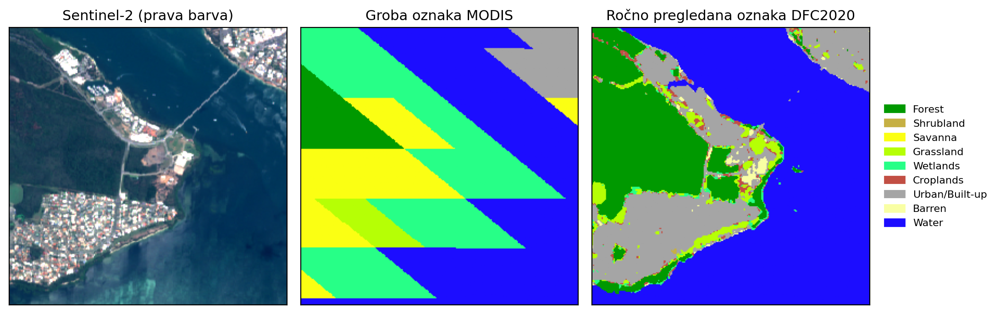
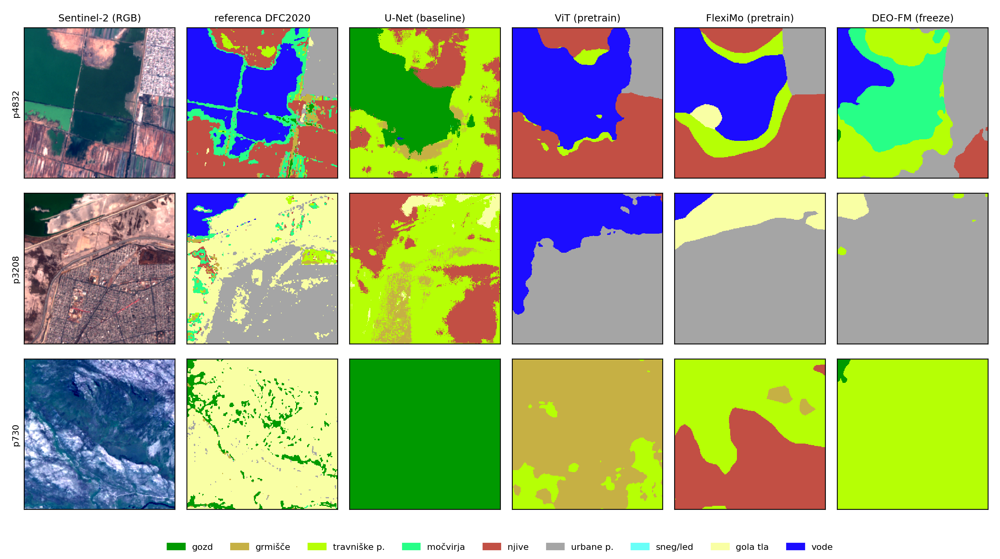

# Master thesis


## Training Labels

The contest pairs Sentinel-1/2 imagery with two very different label sources: coarse
MODIS land cover, used for training, and a manually reviewed high-resolution DFC2020
reference, used only for evaluation. Learning the second from the first is the problem
this repository addresses.




## Supported Models

| Model | Architecture |
|-------|-------------|
| **DeepLabv3+** | ResNet-101 backbone, ASPP, configurable output stride |
| **UNet** | 5-level encoder/decoder with skip connections | `bilinear` (True, False) |
| **Swin Transformer** | Shifted window attention |
| **Copernicus FM** | Copernicus Foundation Model |
| **UNetFormer** | UNet + Transformer hybrid |
| **CROMA** | Cross-modal attention (multi-modal) |
| **FlexiMo** | Flexible multi-modal model |
| **DINOv2** | Self-supervised ViT features |
| **OneFormer** | Universal image segmentation transformer |
| **DEO-FM** | Dual-teacher distilled multispectral EO model |
| **ViT** | Plain Vision Transformer (ImageNet / MAE weights) |


## Land Cover Classes


## Prerequisites

An NVIDIA GPU with a recent driver is recommended for training.

### Run Locally

Install the dependencies from `pyproject.toml`:

```bash
pip install -e ".[dev]"
```

Key requirements: Python 3.12+, PyTorch 2.6.0, GDAL/rasterio, scikit-learn (see `pyproject.toml` for the full list).


## Configuration

The project uses a **single-file configuration approach**. All common and model-specific
parameters go in one `args_file.txt`. The `model=` key is **required**. See
`args_file.txt.example` for a fully annotated reference.

> **Test / CI args files:** The `args_files/` directory contains ready-to-use args files for
> each supported model (`args_reproducible_test_<model>.txt`). These use a small sample
> dataset (`data_small`) with minimal settings and are intended for **testing and CI/CD** only,
> not for real training runs.

### Input Bands

| Sensor | Bands | Channels | Args Flag |
|--------|-------|----------|-----------|
| S2 HR (10m) | Bands 2, 3, 4, 8 | 4 | `use_s2hr=True` |
| S2 MR (20m) | Bands 5, 6, 7, 9, 12, 13 | 6 | `use_s2mr=True` |
| S2 LR (60m) | Bands 1, 10, 11 | 3 | `use_s2lr=True` |
| S1 VV/VH | SAR polarizations | 2 | `use_s1=True` |


## Quick Start

Run the example pipeline (trains, predicts, plots, analyzes with test data):

```bash
python -m src.continuous_run --example
```

Or with a specific model:

```bash
python -m src.continuous_run --example --model unet
```


## Training

```bash
python -m src.train --args_file_path args_file.txt
```

Training includes:
- Configurable validation frequency (`val_freq`) and checkpointing (`save_freq`)
- TensorBoard logging (model graphs, weight histograms, confusion matrices, per-class metrics)
- PyTorch profiler integration (`enable_profiling=true`)
- Resumable training from checkpoints

If you want to use your GPU, run as `CUDA_VISIBLE_DEVICES=x python -m src.train ...` since multi-GPU training is not supported.


## Inference

```bash
python -m src.predict --args_file_path args_file.txt
```

Outputs uint8 TIFF label maps and optional RGB preview composites. Supports scoring against ground truth with `score=True` in the args file.


## Full Pipeline

The continuous run script executes all stages in sequence: train, predict, plot, analyze, and report:

```bash
python -m src.continuous_run \
  --args_file_path args_file.txt \
  --report-format pdf
```


## Results

mIoU on DFC2020, across training variants. Columns are the baseline (trained from
scratch), pretrained encoder weights, a frozen encoder, the two noise-robust losses
(GCE, SCE), an edge-aware variant, and that variant combined with pretraining.

| Model | Baseline | Pretrained | Frozen | GCE | SCE | Edges | Edges + Pre. |
|-------|---------:|-----------:|-------:|----:|----:|------:|-------------:|
| U-Net | 0.2325 | 0.2537 | 0.2302 | 0.2417 | 0.2493 | 0.2355 | 0.2496 |
| DeepLabv3+ | 0.2213 | 0.2351 | 0.1543 | 0.2044 | 0.2186 | 0.2255 | 0.1883 |
| Swin | 0.2264 | 0.2909 | 0.2826 | 0.2085 | 0.2435 | 0.2188 | 0.2939 |
| UNetFormer | 0.2076 | 0.1886 | 0.1849 | 0.2043 | 0.2043 | 0.2090 | 0.1815 |
| OneFormer | **0.2385** | 0.2421 | 0.2787 | 0.0857 | 0.0905 | **0.2370** | 0.2853 |
| ViT | 0.2284 | **0.3031** | **0.2984** | **0.2979** † | **0.2984** † | 0.2292 ‡ | **0.3022** |
| DINOv2 ᶻ | – | – | 0.2112 | 0.2048 | 0.2024 | – | 0.2099 |
| CROMA ᶻ | – | – | 0.2800 | 0.2813 | 0.2812 | – | 0.2796 |
| FlexiMo ᴾ | – | **0.3101** | – | 0.3059 | **0.3127** | – | **0.3115** |
| Copernicus-FM ᶻ | – | – | 0.2818 | 0.2716 | 0.2769 | – | 0.2804 |
| DEO-FM ᶻ | – | – | 0.3101 | **0.3105** | **0.3102** | – | 0.3098 |

Bold marks the best value per column within each block; `–` marks a configuration that does not apply to that model.

- ᶻ — evaluated with a frozen encoder only.
- ᴾ — always uses pretrained weights, so comparable to the **Pretrained** column rather than the baseline.
- † — this run also used pretrained weights, so it is comparable to the **Pretrained** column rather than the baseline.
- ‡ — the run log and configuration for this result are not included in this repository.

The configurations of all other runs are in [`args_files/thesis/`](args_files/thesis/).

The strongest single result is FlexiMo with SCE (0.3127); ViT is the strongest of the
models trainable from scratch (0.3031 pretrained).



Predictions on three DFC2020 tiles. The colour key is the same as in
[Land Cover Classes](#land-cover-classes) above; panel legends are in Slovenian.


## Features

### Learning Rate Scheduling

Cosine annealing with linear warmup:

```ini
lr_scheduler=cosine
lr_warmup_epochs=5
lr_min=0.0
lr_decay_rate=0.99
```

### Reporting

Generate reports (PDF, HTML) with training curves, confusion matrices, per-class metrics, and sample predictions:

```bash
python -m src.continuous_run \
  --args_file_path args_file.txt \
  --report-format all
```

### Timing System

Execution timing for all pipeline components with TensorBoard integration:

```ini
enable_timing=true
```


## Data

### SEN12MS Dataset Structure

The SEN12MS dataset can be obtained from: https://mediatum.ub.tum.de/1474000

Use the official train/holdout splits via `SEN12MS_holdOutScenes.txt` from the [SEN12MS Toolbox](https://github.com/MSchmitt1984/SEN12MS/blob/master/splits/SEN12MS_holdOutScenes.txt).

```
root/
├── ROIs1158_spring/
│   ├── s1_1/
│   ├── s2_1/
│   ├── lc_1/
│   └── ...
├── ROIs2017_winter/
├── ROIs1868_summer/
├── ROIs1970_fall/
└── SEN12MS_holdOutScenes.txt
```

### DFC2020 Dataset Structure

DFC2020 data: https://ieee-dataport.org/competitions/2020-ieee-grss-data-fusion-contest

```
root/
├── ROIs0000_validation/
│   ├── s1_validation/
│   ├── s2_validation/
│   ├── lc_validation/
│   └── dfc_validation/
└── ROIs0000_test/
    ├── s1_0/
    ├── s2_0/
    ├── lc_0/
    └── dfc_0/
```

## TensorBoard

Training logs are written to `log_dir` every `log_freq` optimization steps.

```bash
tensorboard --bind_all --logdir ./logs
```

Navigate to http://localhost:6006.

Features logged: scalars (loss, validation metrics), images (inputs, predictions, ground truth), model graph, activation distributions, weight/gradient histograms, hyperparameters (multi-run comparison), confusion matrices, per-class metrics.


## License

GNU General Public License v3.0, see [LICENSE](LICENSE).


## Use of AI in development

Parts of this code base were developed with the help of
[Claude Code](https://claude.com/claude-code) (Anthropic), an AI coding assistant. The author used Claude Opus models. The author
reviewed, tested and is responsible for all code in this repository.

## What the AI tool was used for

1. **Docstrings.** Writing docstrings for functions, classes and modules across `src/`
   (January – October 2026).
2. **Comments.** Writing comments in the code.
3. **Reporting module.** The PDF/HTML report generator in [`src/reporting/`](src/reporting/)
   was generated with the AI tool (January – March 2026, with later small changes).
4. **Validating the model code.** Checking that pretrained weights load correctly into the
   model implementations in [`src/models/`](src/models/): comparing state-dict keys and shapes
   with the published checkpoints and fixing loading mismatches.
5. **Preparing this repository** (October 2026). Removing development-only modules,
   writing the provenance headers in `src/models/` and 
   writing README.md.

## How the output was checked

- Review of the generated code by the author.
- Static checks: `ruff check`, `ruff format --check` and `mypy`.
- End-to-end smoke tests on the bundled sample data for every model
  (`python -m src.continuous_run --example --model <model>`).


# Third-Party Code, Weights and Data

Every adapted file starts with a header naming its source, licence and the paper it implements.

## Implemented from papers

Model files were written for this project from the papers. Module and parameter names follow the reference implementation so the published
checkpoints load.

| Model | Paper | Reference implementation |
|-------|-------|--------------------------|
| CROMA | Fuller et al., NeurIPS 2023 | [antofuller/CROMA](https://github.com/antofuller/CROMA) |
| Copernicus-FM (wrapper, encoder) | Wang et al., arXiv:2503.11849, 2025 | [zhu-xlab/Copernicus-FM](https://github.com/zhu-xlab/Copernicus-FM) |
| DINOv2 | Oquab et al., arXiv:2304.07193, 2023 | [facebookresearch/dinov2](https://github.com/facebookresearch/dinov2) |
| DEO-FM (wrapper, weights, Swin trunk) | Wolf et al., CVPR 2026 | [wolfilip/DEO-FM](https://github.com/wolfilip/DEO-FM) |
| FlexiMo (wrapper, encoder, PI-resize) | Li et al., IEEE TGRS 2026; Beyer et al., CVPR 2023 | [danfenghong/IEEE_TGRS_Fleximo](https://github.com/danfenghong/IEEE_TGRS_Fleximo) |
| UNetFormer (wrapper, encoder) | Wang et al., ISPRS J. Photogramm. Remote Sens. 2022 | [WangLibo1995/GeoSeg](https://github.com/WangLibo1995/GeoSeg) |
| Swin Transformer (wrapper) | Liu et al., ICCV 2021 | [microsoft/Swin-Transformer](https://github.com/microsoft/Swin-Transformer) |
| ViT | Dosovitskiy et al., ICLR 2021 | [google-research/vision_transformer](https://github.com/google-research/vision_transformer) |
| OneFormer | Jain et al., CVPR 2023 | [SHI-Labs/OneFormer](https://github.com/SHI-Labs/OneFormer) (used through Hugging Face `transformers`) |

## Pretrained weights

No weights are stored in this repository. They are downloaded at runtime from their original
sources (torchvision, timm, `torch.hub`, and the Hugging Face Hub repositories `antofuller/CROMA`,
`earthflow/DOFA`, `wangyi111/Copernicus-FM`, `SolaireTheSun/DEO`, `shi-labs/oneformer_*`).

## Data

`data_small/` contains a few patches from SEN12MS, used only for smoke tests. SEN12MS is
shared under the CC BY licence:

> M. Schmitt, L. H. Hughes, C. Qiu, X. X. Zhu, "SEN12MS – A Curated Dataset of Georeferenced
> Multi-Spectral Sentinel-1/2 Imagery for Deep Learning and Data Fusion", ISPRS Annals,
> IV-2/W7, 2019. https://mediatum.ub.tum.de/1474000
